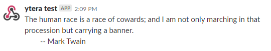
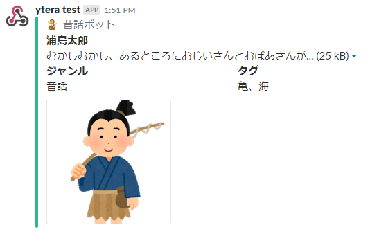

Yabumi
======

Command line tool for post the message to slack.

Installation
------------

### Homebrew

```bash
$ brew install --cask yteraoka/cask/yabumi
```

### GitHub Releases

Download the archive for your OS and architecture from
[GitHub Releases](https://github.com/yteraoka/yabumi/releases), extract it, and place the
`yabumi` binary in a directory on your `PATH`.

```bash
$ VERSION=$(curl -sSL -o /dev/null -w '%{url_effective}' https://github.com/yteraoka/yabumi/releases/latest | sed 's|.*/v||')
$ curl -sSLO https://github.com/yteraoka/yabumi/releases/download/v${VERSION}/yabumi_${VERSION}_linux_amd64.tar.gz
$ tar xzf yabumi_${VERSION}_linux_amd64.tar.gz yabumi
$ sudo install yabumi /usr/local/bin/
```

Archives are available for `linux`, `darwin` and `windows` on `amd64` and `arm64`.
Verify the download with `checksums.txt` attached to each release.

### go install

```bash
$ go install github.com/yteraoka/yabumi@latest
```

Usage
-----

```
Usage:
  yabumi [OPTIONS] [Url]

Application Options:
  -C, --channel=          slack channel to post
  -a, --attachment        use attachment
  -t, --title=            Title text (attachment)
      --title-link=       Title link url (attachment)
  -c, --color=            Color code or 'good', 'warning', 'danger' (attachment)
  -p, --pretext=          optional text that appears above the message
                          attachment block (attachment)
      --author-name=      author_name (attachment)
      --author-link=      author_link (attachment)
      --author-icon=      author_icon (attachment)
      --image-url=        image url (attachment)
      --thumb-url=        thumbnail image url (attachment)
      --footer=           footer text (attachment)
      --footer-icon=      footer icon url (attachment)
  -m, --message=          pass message instead of read stdin
  -f, --field=            "title|value|short" (attachment)
  -M, --disable-markdown  disable markdown processing
      --timeout=          HTTP request timeout per attempt (default: 3s)
      --retry=            number of retries on failure (0 disables retry)
                          (default: 2)
  -D, --debug             enable debug mode. do not send request, show json only
  -v, --version           show version

Help Options:
  -h, --help              Show this help message

Arguments:
  Url:                    slack webhook endpoint url (default:
                          $SLACK_WEBHOOK_URL)
```

Simple message
--------------

```bash
$ fortune | ./yabumi https://hooks.slack.com/services/xxx/yyy/zzzz
```



The webhook URL can also be given by the `SLACK_WEBHOOK_URL` environment variable.
The argument takes precedence if both are given. Using the environment variable is recommended
so that the URL does not remain in your shell history or the process list.

```bash
$ export SLACK_WEBHOOK_URL=https://hooks.slack.com/services/xxx/yyy/zzzz
$ fortune | ./yabumi
```

An empty message (empty stdin or `--message ""`) is rejected before sending,
because Slack responds with `400 no_text`.

Retry
-----

When posting fails, yabumi retries the request.

- The number of retries is set by `--retry` (default: `2`, so up to 3 attempts in total).
  `--retry 0` disables retry.
- Each attempt times out after `--timeout` (default: `3s`).
- Retried: network errors (including timeouts), `429 Too Many Requests` and `5xx` responses.
- Not retried: other `4xx` responses such as `400 invalid_payload` or `404 no_service`,
  since sending the same request again would fail the same way.
- The wait between attempts grows exponentially: 1s, 2s, 4s, ...
  For `429`, the `Retry-After` header is honored if it is longer (capped at 30s).
- If all attempts fail, yabumi exits with status `1` and logs the response status and body.

```bash
$ fortune | ./yabumi --timeout 10s --retry 5
```

> [!NOTE]
> `--channel` only works with legacy Incoming Webhooks (the custom integration).
> Webhook URLs issued by a Slack App are bound to a single channel, and Slack ignores
> the `channel` field for them. Create a webhook for each channel you want to post to.

Attachment
----------

```bash
$ echo -e "むかしむかし、あるところにおじいさんとおばあさんが..." | ./yabumi \
 -a \
 --color good \
 --pretext "ぷれてきすと" \
 --author-name "昔話ボット" \
 --author-icon "https://3.bp.blogspot.com/-ixMmPNVQHYs/Ws2uyQlDBxI/AAAAAAABLRQ/FtMx5Tz8SGcKtPLC1IDbc4m9EVQ39edmQCLcBGAs/s180-c/fantasy_akuma_purson.png" \
 --title "浦島太郎" \
 --image-url https://2.bp.blogspot.com/-wZyXlcpBXBU/WvQHkT9wodI/AAAAAAABL78/p8xjPHseoM8E-FSdZDATMMSlAiy0EhxIQCLcBGAs/s180-c/mukashibanashi_ryoushi.png \
 --field "ジャンル|昔話|true" \
 --field "タグ|亀、海|true" \
 https://hooks.slack.com/services/xxx/yyy/zzzz
```


